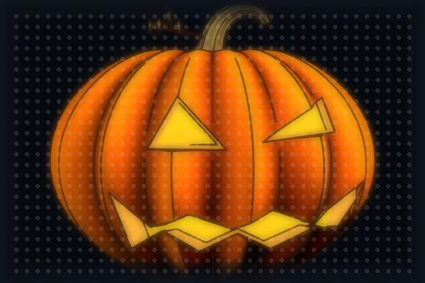
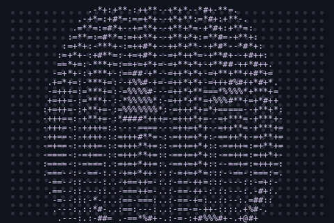
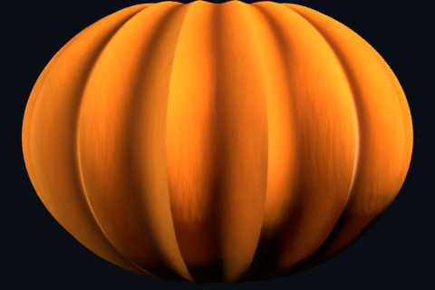
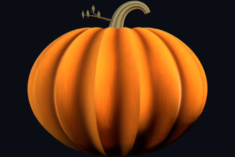
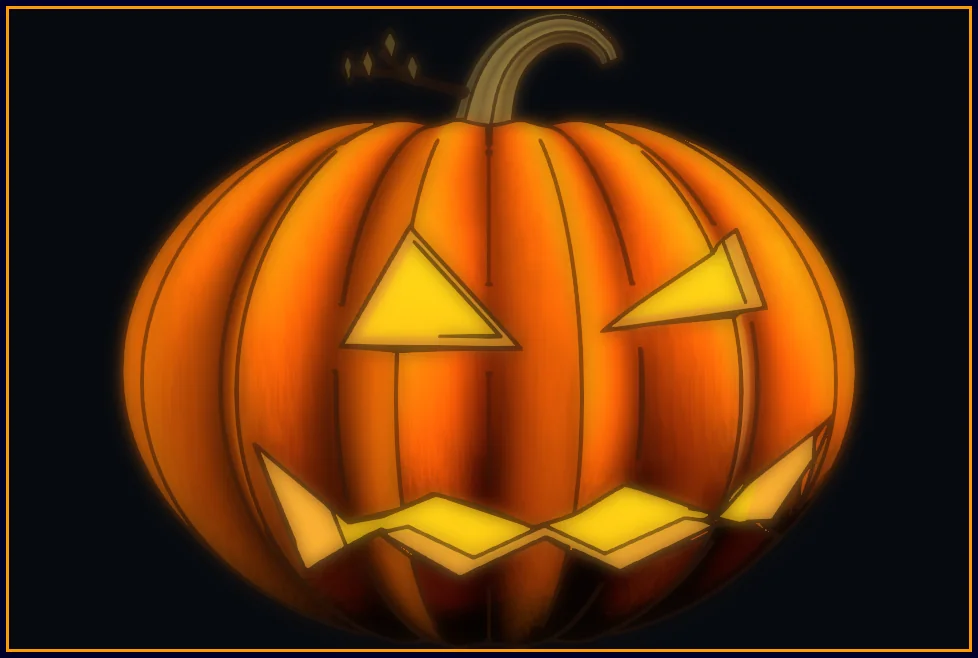

# pumpkin-carve

build a jack-o-lantern in blender, then grade it in photocraft.
six steps, two tracks per step (by hand, or in python). this page is
the map — [the tutorial](tutorial/tutorial.md) is the walk.

<table>
  <tr>
    <td width="33%"></td>
    <td width="33%"></td>
    <td width="33%"></td>
  </tr>
  <tr>
    <td align="center">the render, graded</td>
    <td align="center">the model, turning</td>
    <td align="center">the same, as text</td>
  </tr>
</table>

## start

1. install blender 4.4 and photocraft 0.17.
2. open [the tutorial](tutorial/tutorial.md), keep it beside blender.
3. work the steps in order. stuck points and fixes close each step.

## the six steps

<table>
  <tr>
    <td width="180"></td>
    <td><b>1 · ribbed body</b> — 15 grooves, real rind, groove mask for later shading.<br>
    <a href="tutorial/tutorial.md">tutorial step 1</a> · <a href="tutorial/examples/01-body.blend">example .blend</a></td>
  </tr>
  <tr>
    <td></td>
    <td><b>2 · stem, twig, leaves</b> — bent bark stem, broken hollow tip, flat-lying leaves.<br>
    <a href="tutorial/tutorial.md">tutorial step 2</a> · <a href="tutorial/examples/02-stem.blend">example .blend</a></td>
  </tr>
  <tr>
    <td></td>
    <td><b>3 · carve the face</b> — boolean cuts, pale funnels, amber glow, light inside.<br>
    <a href="tutorial/tutorial.md">tutorial step 3</a> · <a href="tutorial/examples/03-carved-face.blend">example .blend</a></td>
  </tr>
  <tr>
    <td></td>
    <td><b>4 · shading layers</b> — toon color, groove shading, streaks, silhouette rim. node tree, socket by socket.<br>
    <a href="tutorial/tutorial.md">tutorial step 4</a></td>
  </tr>
  <tr>
    <td></td>
    <td><b>5 · ink with grease pencil</b> — line art outlines, then a white-background drawing variant.<br>
    <a href="tutorial/tutorial.md">tutorial step 5</a> · <a href="tutorial/examples/04-inked-final.blend">example .blend</a></td>
  </tr>
  <tr>
    <td></td>
    <td><b>6 · grade in photocraft</b> — vibrance, warm filter, screen-blend glow. same steps as terminal commands in <code>post/post.sh</code>.<br>
    <a href="tutorial/tutorial.md">tutorial step 6</a></td>
  </tr>
</table>

in a hurry? open `blender/scene.blend`, or rebuild it all:

```
blender -b --factory-startup --python-exit-code 1 -P blender/build_pumpkin.py
```

variations (`-- --toon`, `-- --preview`, `-- --stage=1`…`4`): tutorial,
"run the whole build". outputs land in `blender/exports/`.

## files

| path                   | what                                           |
| ---------------------- | ---------------------------------------------- |
| `tutorial/tutorial.md` | the walkthrough — start here                   |
| `tutorial/examples/`   | one scene + render per stage                   |
| `blender/`             | `build_pumpkin.py` (annotated) + `scene.blend` |
| `post/`                | step-6 grade: script, images, layered psd      |
| `assets/`              | images on this page + their makers             |
| `refs/`                | look-target drawings (tutorial step 3)         |

<p align="center">
  <br>
  hand-drawn svg — open it in a browser, watch the candlelight.
</p>

```
                                   .:===.
                                   .====
                          .:..:-. .-----:: .-:..:.
                       .-+==+**=-=*#*-:+*#*-=**+==+=.
                     :=*+-=**+-:+=**+--+**+*--***=-**=:.
                   :=**=.=#*+=:=+=**+--+**+**:=**#=:+**=:
                 .-+**=.=#**+:-+=+**+--++*++*=:+**#=:=**+=.
                :=+*+=:-#**+-:=+=***+--++**+*+:-+**#=:=**++:
               :=+*+=:-***+=:-=+=#**+--=+**+**-:+**#*=:+*#++-
              -=+*+=::+#**+-:-+++#**+--=+**+**+:=+**#*--+*#++-
             :==**+-:=#***+::=+=*#**+--=++*++*+--+***#+-=**#++-
            .+=**+=:-*#**+=:-=+-+#**+--=++**+*+=-++**#*=--**#+*.
            +=+*+=-:=****+-:-+=*==**+--=++**+**=:=+***#==*=*#*++
           -+=**+=:-+***+=-:===%%-=*+--=+++*+**+-=+***+*#*=**#+*-
          .+=+*+=-:-****+=::=-#%%#-=*--==++*+**+--+*++#%%*++*#*=*.
          -+=*++=::=***++-:--+%%%%#-==:==++*+**+==+=*%%%%*+=**#+*=
          +=+++=-:-+***+=-:--%%%%%%#----=++*++*+=-=#%%%%%#*=+***+*
         :+=+++=-:-****+=--:*%%%%%%%*::-=++*++**=+%%##*++==-+**#=*:
         -+=++==-:=***++=-:=%%%%%%%%%*:-=+++++*-=+===-====--+**#+*=
         ==+++==::=***+=-::*##%###**++==-+++++*==--=++**#+=-+****++
         +=++==-:-=++++=-::-------==-----+++++**+--==+++*+=:++***++
         +=++==-:-=++++=-:-==+=***++=:::==+++=**+-:==+++*+=:=+***++
         +=+===-:-=++++=-::=++=****+=::--=+++=**+-:-==++*+=:=++**++
         +=+===-:-=+++=-:.:=++=****+=:::-=++==**+-:--==+*+=:=++**++
         ==+==--:-=++==-:.:=++=***++-:::-=++==**+-:--===++=:=+++*++
         -====--:--====-:.:-=+=***++-:.:-==+==*++::---==++=:=++++==
         :====--::-===--:.:-=+=+*++=-:.:-==+==*+=:::---===-:==++:=-
         .====--::--==-::.:-=+=++++=-:.:-=====*+=:.::---==::===-:=.
          -===--::-::--::.:-=+=++++=:..:-===-=*+-:.::-----::--*+:-
          :-==--::-:=--::..-=+-=++=-:..:-===-=+=-:.:::---:.:-*%--:
           --=--:.::=*:::..:=+--++=-:..:--==-=+=:...::---:.-#%+::
           .-=--:::-:##-...:-+=-=---:..:--==-==-=-...::::.+##*:..
            :----:.::=%#=..:-=-:-++-. .:--==---*%%#+-:::.=%##- .
             :---:.:::###=..:-=*%%%%#+:::----+%%%%%@%+=.-%##+
              :--::.::+##*+**+#**%%%%%%#=--+#%%%%%#*+**..:::
               :-::..:-###**:.-**+*%%%##*===+#%%#++##=:
                :-::..:##*: .-::+#*+**+=---::=+*+##=. .  .
                 :::...==  ..:=- -*#*=:.:---  .=*=....
```
