# pumpkin-carve

build a jack-o-lantern in blender, then finish it in photocraft.
the process: squash a sphere into a ribbed pumpkin, sweep a bark
stem along a curve, cut the eyes and grin through the rind with
booleans and line the holes with glowing flesh, shade it with
shader nodes, trace it with grease pencil ink, then open the
render in photocraft for vibrance, warmth, and a candlelit glow.
six steps, two tracks per step (by hand in the interface, or in
annotated python), full instructions in
[the tutorial](tutorial/tutorial.md).

<table>
  <tr>
    <td width="33%"></td>
    <td width="33%"></td>
    <td width="33%"></td>
  </tr>
</table>

## start

1. install blender 4.4 and photocraft 0.17.
2. open [the tutorial](tutorial/tutorial.md), keep it beside blender.
3. work the steps in order. stuck points and fixes close each step.

## the six steps

<table>
  <tr>
    <td width="180">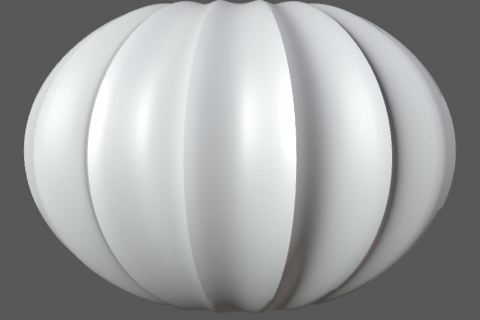</td>
    <td><b>1 · ribbed body</b> — start from a uv sphere, scale it squat, sink every other edge loop to carve 15 grooves, then solidify so the rind has real thickness. in code the same shape is one polar grid, and each vertex remembers whether it sits in a groove — step 4 shades with that memory.<br>
    <a href="tutorial/tutorial.md">tutorial step 1</a> · <a href="tutorial/examples/01-body.blend">example .blend</a></td>
  </tr>
  <tr>
    <td>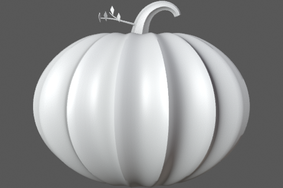</td>
    <td><b>2 · stem, twig, leaves</b> — draw a bezier hook, bevel it thick at the base and thin at the tip, ridge it like bark, leave the end open with a dark disc inside so it reads snapped. a thin twig and four leaves lying flat finish it.<br>
    <a href="tutorial/tutorial.md">tutorial step 2</a> · <a href="tutorial/examples/02-stem.blend">example .blend</a></td>
  </tr>
  <tr>
    <td>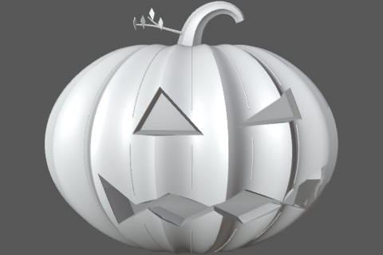</td>
    <td><b>3 · carve the face</b> — shape two triangles and a zigzag grin as flat cutters, boolean-difference them through the rind, then build a pale funnel inside each hole capped with amber emission. one small light inside the body lights the cuts from within.<br>
    <a href="tutorial/tutorial.md">tutorial step 3</a> · <a href="tutorial/examples/03-carved-face.blend">example .blend</a></td>
  </tr>
  <tr>
    <td></td>
    <td><b>4 · shading layers</b> — in the shader editor: a toon bsdf for flat color, the step-1 groove mask mixing lit orange into dark valley brown, two noise textures streaked over the top so it never looks like plastic, and an emission rim gated to the silhouette only. the tutorial wires it node by node.<br>
    <a href="tutorial/tutorial.md">tutorial step 4</a></td>
  </tr>
  <tr>
    <td></td>
    <td><b>5 · ink with grease pencil</b> — add a grease pencil stroke object with a line art modifier aimed at the pumpkin collection: it traces contour, crease, and intersection lines in near-black brown. render again on white with thicker lines and you get a printable drawing of your pumpkin.<br>
    <a href="tutorial/tutorial.md">tutorial step 5</a> · <a href="tutorial/examples/04-inked-final.blend">example .blend</a></td>
  </tr>
  <tr>
    <td></td>
    <td><b>6 · finish in photocraft</b> — photocraft is an open-source rust editor (layers, masks, real psd files, offline). open the render: vibrance +35, contrast +22, warm photo filter at 18%, then duplicate the layer, blur it, and screen-blend at 60% so highlights bloom. save a flat png to share and a layered <code>.psd</code> to keep editing. <code>post/post.sh</code> runs the identical five steps from the terminal.<br>
    <a href="tutorial/tutorial.md">tutorial step 6</a></td>
  </tr>
</table>

## ten more pumpkins

ten cultivars, ten separate scripts in `blender/cultivars/` — each
pairs one blender technique with one photocraft feature. full
briefs, reference photos, and doc links live in the [cultivar gallery](tutorial/tutorial.md#ten-more-pumpkins-cultivar-gallery).

|                                                                                       | pumpkin                             | blender feature      | photocraft feature               |
| ------------------------------------------------------------------------------------- | ----------------------------------- | -------------------- | -------------------------------- |
| 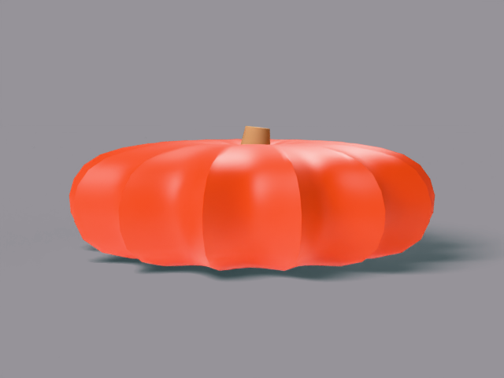                 | cinderella — flat red heirloom      | profile lathe        | curves s-curve, live psd         |
| 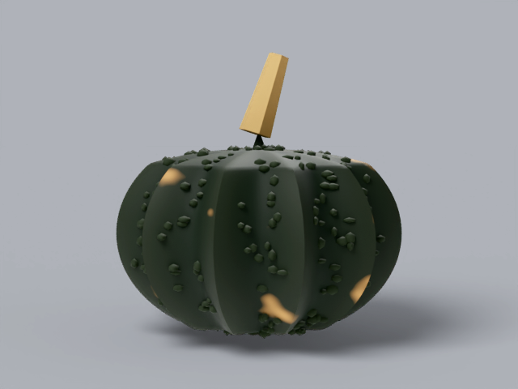               | black futsu — dark warted block     | geo-nodes scatter    | brightness/contrast lift         |
| 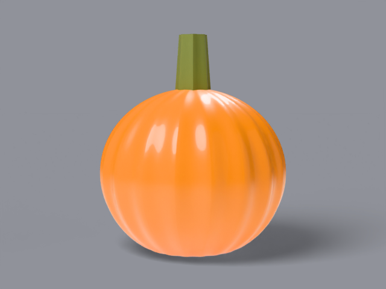                   | sugar pie — small neat ball         | primitive + subsurf  | hue/sat warm shift               |
| 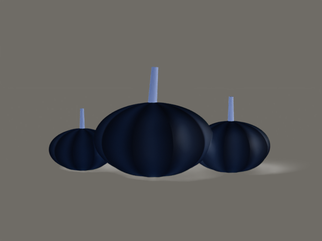                     | baby boo — mini white cluster       | linked duplicates    | invert negative                  |
| 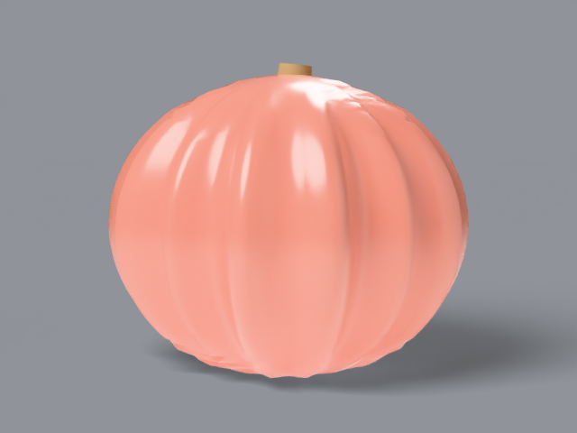         | porcelain doll — pink glossy block  | cube spherify        | outer glow layer style, live psd |
| 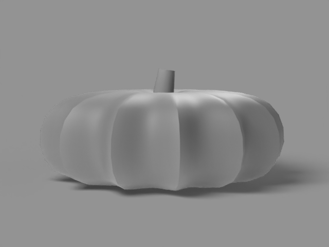                 | jarrahdale — blue-grey drum         | sheen bloom          | gradient-map duotone, live psd   |
| 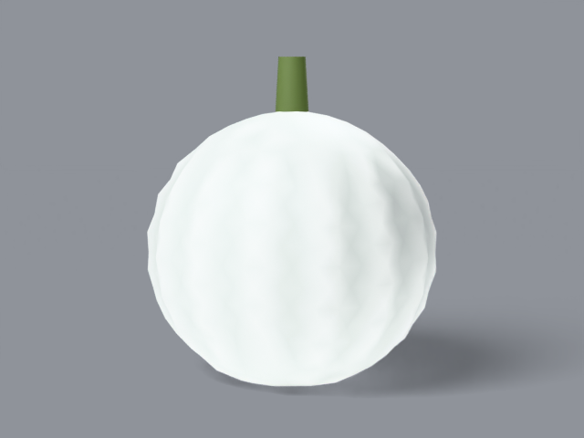                         | lumina — smooth white ball          | subsurface skin      | cooling photo filter             |
| 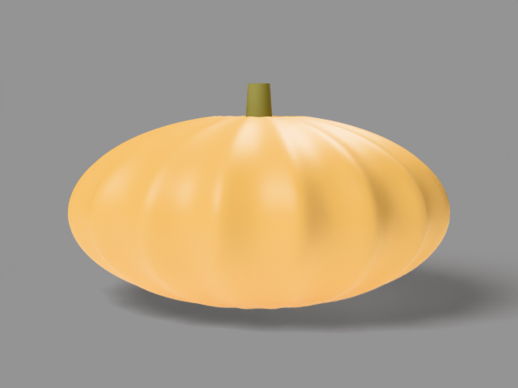 | long island cheese — flat tan wheel | boolean socket       | warm color balance               |
| 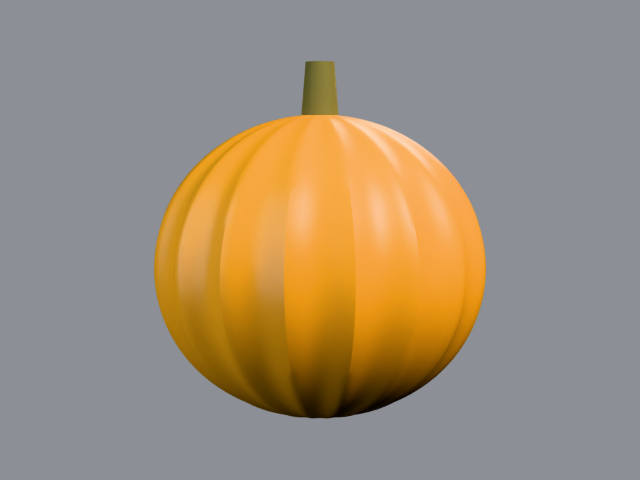             | harvest moon — big golden ball      | documented light rig | levels black point               |
| 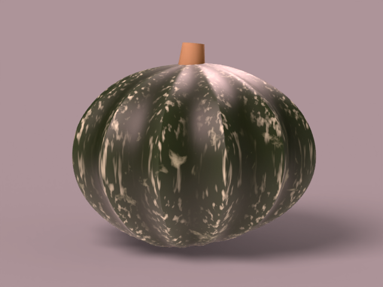                       | kabocha — mottled green drum        | noise + displace     | channel mixer                    |

open `blender/scene.blend` to take the finished pumpkin apart, or
rebuild it all:

```
blender -b --factory-startup --python-exit-code 1 -P blender/build_pumpkin.py
```

variations (`-- --toon`, `-- --preview`, `-- --stage=1`…`4`): tutorial,
"run the whole build". outputs land in `blender/exports/`.

## files

| path                   | what                                           |
| ---------------------- | ---------------------------------------------- |
| `tutorial/tutorial.md` | the walkthrough — start here                   |
| `tutorial/examples/`   | one scene + render per stage                   |
| `blender/`             | `build_pumpkin.py` (annotated) + `scene.blend` |
| `post/`                | step-6 grade: script, images, layered psd      |
| `assets/`              | images on this page + their makers             |
| `refs/`                | look-target drawings (tutorial step 3)         |
