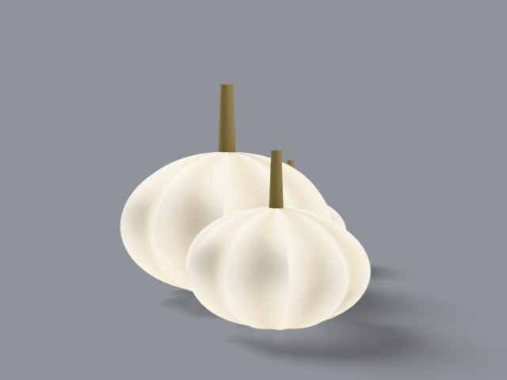

# baby boo

miniature white pumpkin, _cucurbita pepo_. about 8 cm across,
palm size. grows in clusters.

## what it looks like, top to bottom

crown: flat disc top with a thin upright stem. ribs: 10 deep ribs
for its size. skin: creamy ghost-white, smooth, matte. stem:
thin, upright, green-brown. bottom: sits flat. uncarved — too
small to carve honestly. shown as a cluster of three minis at
varied rotation and scale.

reference photos: [`refs/baby-boo/`](../../refs/baby-boo/) —
`front.jpg`, `profile.jpg`. full spec:
[`refs/baby-boo/README.md`](../../refs/baby-boo/README.md).

## build

`blender/cultivars/baby_boo.py` — one script, no shared parameters.

1. one small ribbed body from a polar grid.
2. two [linked duplicates](https://docs.blender.org/manual/en/latest/scene_layout/object/editing/linked_duplicates.html)
   placed beside the hero at varied rotation and scale — same
   mesh, no rebuild. one material edit restyles the cluster.

rebuild: `blender -b --factory-startup --python-exit-code 1 -P blender/cultivars/baby_boo.py`

blender feature: linked duplicates / collection instancing for
repeated props.

## finish in photocraft

warm filter + lift — the showcase stays a white pumpkin, not a
negative:

```
photocraft-cli run tutorial/variants/baby-boo.png \
  --cmd image.adjustments.photoFilter \
  --params '{"color":"#fff2df","density":10}' \
  --cmd image.adjustments.brightnessContrast \
  --params '{"brightness":4,"contrast":10}' \
  --out post/variants/baby-boo.png
```

the invert ghost ships beside it as `baby-boo-invert.png` — same
fruit, graphic extra, not the display piece.

## renders





## scorecard

rubric: silhouette, ribs, color, surface, stem — mean, pass at 8.0.

| round | sil | ribs | color | surf | stem | mean | notes                                                                                                                                              |
| ----- | --- | ---- | ----- | ---- | ---- | ---- | -------------------------------------------------------------------------------------------------------------------------------------------------- |
| r1    | 8   | 8    | 8     | 7    | 7    | 7.6  | long stems, loose cluster                                                                                                                          |
| r2    | 8   | 8    | 8     | 8    | 8    | 8.0  | deeper ribs, tight cluster, short stems                                                                                                            |
| r3    | 9   | 9    | 8     | 8    | 9    | 8.6  | PASS — plumper body, crown dip, freckles, tall green ridged stem with star base, hero composition; beauty grade showcases, invert demoted to extra |
