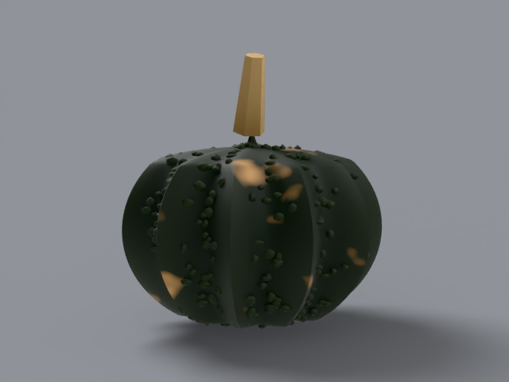

# black futsu

japanese heirloom, _cucurbita moschata_. 3–5 lb, squat and blocky.
starts near-black green with warts, cures toward tawny buff.

## what it looks like, top to bottom

crown: flat top with a hard angular tan stem leaning off it. ribs:
10–12 heavy ribs crusted with wart rows along the crests. skin:
near-black green curing to buff patches on the rib tops, dusty
bloom when young. stem: hard, angular, faceted, medium length.
bottom: flat. uncarved — display fruit.

reference photos: [`refs/black-futsu/`](../../refs/black-futsu/) —
`front.jpg`, `profile.jpg`. full spec:
[`refs/black-futsu/README.md`](../../refs/black-futsu/README.md).

## build

`blender/cultivars/black_futsu.py` — one script, no shared parameters.

1. ribbed polar body, squat proportions, flat top and sit-flat
   bottom.
2. geometry nodes: distribute points on faces masked to rib crests
   (groove attribute above 0.55), instance a wart prototype on
   them — real wart geometry, seeded.
3. rind shader: groove mixes base with near-black valleys; noise
   mask paints buff cure patches on the rib tops.

rebuild: `blender -b --factory-startup --python-exit-code 1 -P blender/cultivars/black_futsu.py`

blender feature:
[geometry nodes scatter](https://docs.blender.org/manual/en/latest/modeling/geometry_nodes/index.html) +
[instance on points](https://docs.blender.org/manual/en/latest/modeling/geometry_nodes/point/instance_on_points.html).

## finish in photocraft

brightness/contrast lift — the dark rind needs it for print.
threshold was tried first and ignored its level in photocraft
0.17, so the lift stands in:

```
photocraft-cli run tutorial/variants/black-futsu.png \
  --cmd image.adjustments.brightnessContrast \
  --params '{"brightness":28,"contrast":18}' \
  --out post/variants/black-futsu.png
```

## renders





## scorecard

rubric: silhouette, ribs, color, surface, stem — mean, pass at 8.0.

| round | sil | ribs | color | surf | stem | mean | notes                                                                    |
| ----- | --- | ---- | ----- | ---- | ---- | ---- | ------------------------------------------------------------------------ |
| r1    | 7   | 7    | 7     | 7    | 5    | 6.6  | too tall, small pale stem                                                |
| r2    | 8   | 8    | 8     | 8    | 8    | 8.0  | PASS — squat body, flat top, bigger angular stem with collar, wider cure |
