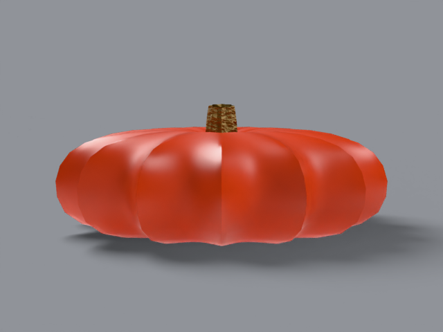

# cinderella (rouge vif d'etampes)

french heirloom, _cucurbita maxima_. 15–20 lb, 12–24 in across, 6 in
tall. the carriage pumpkin.

## what it looks like, top to bottom

crown: concave — the center dips below the rim and the stem seats
into the dip. shoulder: wide and flat, falling steeply to a broad
equator. ribs: 14 deep rounded ribs with sharp valleys. skin:
red-orange, smooth with fine fiber, waxy on the crests and matte
in the valleys. stem: short, corky, tan, seated in the crown dip.
bottom: flattened so the wide fruit sits. uncarved — deep sutures
make real cinderellas hard to carve.

reference photos: [`refs/cinderella/`](../../refs/cinderella/) —
`front.jpg`, `profile.jpg`. full spec:
[`refs/cinderella/README.md`](../../refs/cinderella/README.md).

## build

`blender/cultivars/cinderella.py` — one script, no shared parameters.

1. revolve a measured side profile (flat disc, dipped crown) around
   z, then modulate each ring with a 14-fold rib function.
2. rind shader: groove attribute mixes lit red-orange with dark
   valley red; groove also drives roughness (waxy crests 0.32,
   matte valleys 0.58).
3. stem: ridged corky mesh (8 bark ridges) with fiber bump.

rebuild: `blender -b --factory-startup --python-exit-code 1 -P blender/cultivars/cinderella.py`

blender feature: profile lathe (interface equivalent:
[spin](https://docs.blender.org/manual/en/latest/modeling/meshes/editing/duplicate_extrude/spin.html)).

## finish in photocraft

curves adjustment layer, red-channel s-curve, kept live in the
shipped `.psd`:

```
photocraft-cli run tutorial/variants/cinderella.png \
  --cmd layer.newAdjustmentLayer.curves \
  --cmd layer.setAdjustment \
  --params '{"red":[[0,0],[64,48],[192,208],[255,255]]}' \
  --out post/variants/cinderella.psd
```

## renders





## scorecard

rubric: silhouette, ribs, color, surface, stem — mean, pass at 8.0.

| round | sil | ribs | color | surf | stem | mean | notes                                                                                      |
| ----- | --- | ---- | ----- | ---- | ---- | ---- | ------------------------------------------------------------------------------------------ |
| r1    | 8   | 8    | 6     | 6    | 5    | 6.6  | washed rind, smooth toy stem                                                               |
| r2    | 8   | 8    | 8     | 7    | 8    | 7.8  | deeper red base, corky ridged stem                                                         |
| r3    | 8   | 8    | 8     | 8    | 8    | 8.0  | PASS — groove-driven roughness; a noise-streak attempt read as wood grain and was reverted |
