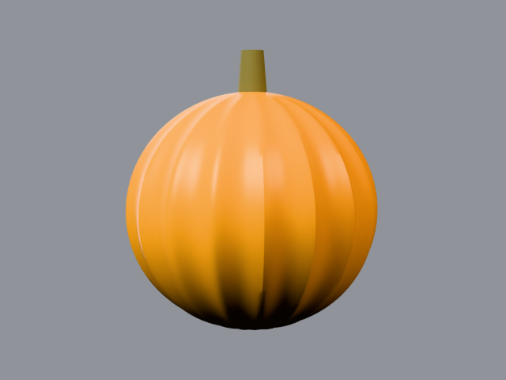

# harvest moon

large golden pumpkin, _cucurbita pepo_. 20–30 lb. big round
fruit, golden yellow smooth skin — the lighting study.

## what it looks like, top to bottom

crown: round top with a thick upright stem. ribs: 16–18 light
ribs, smooth skin, warm sheen. skin: golden yellow. stem: thick,
upright, green-brown. bottom: sits round. uncarved — display
fruit.

reference photos: [`refs/harvest-moon/`](../../refs/harvest-moon/) —
`front.jpg`, `profile.jpg`. full spec:
[`refs/harvest-moon/README.md`](../../refs/harvest-moon/README.md).

## build

`blender/cultivars/harvest_moon.py` — one script, no shared parameters.

1. smooth ribbed globe.
2. the point of the file is the documented three-point
   [area-light](https://docs.blender.org/manual/en/latest/render/lights/index.html)
   rig — warm key, cool fill, warm rim, values in the file — so
   gold reads without blowing out.
3. thick ridged bark stem.

rebuild: `blender -b --factory-startup --python-exit-code 1 -P blender/cultivars/harvest_moon.py`

blender feature: studio lighting with written-down values.

## finish in photocraft

levels — black point in for night contrast, gamma held for rind
detail. compare with cinderella's curves: curves shape, levels
range:

```
photocraft-cli run tutorial/variants/harvest-moon.png \
  --cmd image.adjustments.levels \
  --params '{"shadowInput":18,"gamma":0.95}' \
  --out post/variants/harvest-moon.png
```

## renders





## scorecard

rubric: silhouette, ribs, color, surface, stem — mean, pass at 8.0.

| round | sil | ribs | color | surf | stem | mean | notes                   |
| ----- | --- | ---- | ----- | ---- | ---- | ---- | ----------------------- |
| r1    | 8   | 8    | 8     | 7    | 7    | 7.6  | smooth toy stem         |
| r2    | 8   | 8    | 8     | 8    | 8    | 8.0  | PASS — ridged bark stem |
