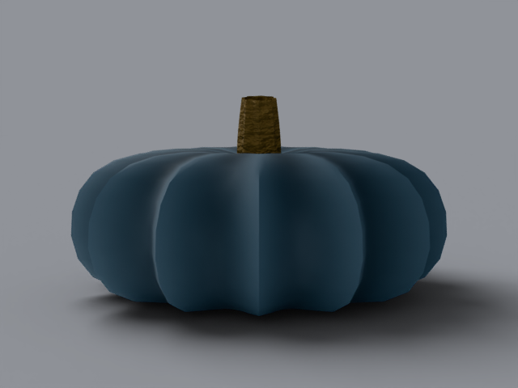

# jarrahdale

australian heirloom, _cucurbita maxima_. 6–10 lb (up to 20+).
slate blue-grey flattened drum with dusty bloom.

## what it looks like, top to bottom

crown: flattened drum top with a sturdy tan stem. ribs: 12–14
deep ribs with dusty pale bloom settled in the valleys. skin:
slate blue-grey, matte, patchy bloom — dusty, never glossy.
stem: sturdy, corky, tan, medium. bottom: flat drum base.
uncarved — display fruit.

reference photos: [`refs/jarrahdale/`](../../refs/jarrahdale/) —
`front.jpg`, `profile.jpg`. full spec:
[`refs/jarrahdale/README.md`](../../refs/jarrahdale/README.md).

## build

`blender/cultivars/jarrahdale.py` — one script, no shared parameters.

1. revolve a drum side profile (flat bottom, bulging wall,
   flattened top); deep ribs modulate each ring.
2. bloom lives in the shader, not the geometry:
   [principled](https://docs.blender.org/manual/en/latest/render/shader_nodes/shader/principled.html)
   base with a noise-broken sheen-free matte — roughness 0.8–1.0
   driven by coarse noise, bloom color masked to rib valleys.
3. dusty fruit wants soft overcast light: key + fill only, no rim
   (the rim etched white crest spots into the matte rind).

rebuild: `blender -b --factory-startup --python-exit-code 1 -P blender/cultivars/jarrahdale.py`

blender feature: matte-by-shader — dusty skin without dusty
vertices. (lesson recorded in `blender/variants.md`: Map Range
From is the input range, To the output range — swapping them
rendered this fruit chrome-smooth for four rounds.)

## finish in photocraft

gradient map duotone, slate shadows to amber highlights, map
kept live in the `.psd`:

```
photocraft-cli run tutorial/variants/jarrahdale.png \
  --cmd layer.newAdjustmentLayer.gradientMap \
  --cmd layer.setAdjustment \
  --params '{"shadows":"#4a5a64","highlights":"#e88a30"}' \
  --out post/variants/jarrahdale.psd
```

## renders





## scorecard

rubric: silhouette, ribs, color, surface, stem — mean, pass at 8.0.

| round | sil | ribs | color | surf | stem | mean | notes                                       |
| ----- | --- | ---- | ----- | ---- | ---- | ---- | ------------------------------------------- |
| r1    | 8   | 7    | 7     | 5    | 6    | 6.6  | glossy, washed out, small stem              |
| r2    | 8   | 8    | 8     | 8    | 8    | 8.0  | PASS — matte shader, soft light, corky stem |
