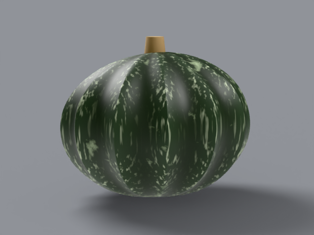

# kabocha

japanese winter squash, _cucurbita maxima_. 2–5 lb. squat drum
with dark forest-green skin, pale celadon mottling and crest
stripes — all procedural, no painted patches.

## what it looks like, top to bottom

crown: flat drum top with a short stubby tan stem. ribs: 12–14
ribs with pale celadon striping along the crests. skin: dark
green with pale mottled patches and faint stripes. stem: short,
stubby, tan. bottom: flat drum base. uncarved — display fruit.

reference photos: [`refs/kabocha/`](../../refs/kabocha/) —
`front.jpg`, `profile.jpg`. full spec:
[`refs/kabocha/README.md`](../../refs/kabocha/README.md).

## build

`blender/cultivars/kabocha.py` — one script, no shared parameters.

1. squat drum body with moderate ribs.
2. [noise texture](https://docs.blender.org/manual/en/latest/render/shader_nodes/textures/noise.html)
   drives both the color mix and a displace modifier, with a
   second stretched mapping for the pale crest stripes.
3. (the musgrave shader node is gone in blender 4.4 — noise with
   distortion stands in; the legacy texture still feeds the
   displace modifier.)

rebuild: `blender -b --factory-startup --python-exit-code 1 -P blender/cultivars/kabocha.py`

blender feature: texture coordinates + mapping for mottling
without painting.

## finish in photocraft

channel mixer — remaps green toward earth. rows are four numbers
(r,g,b,constant):

```
photocraft-cli run tutorial/variants/kabocha.png \
  --cmd image.adjustments.channelMixer \
  --params '{"red":[100,20,0,0],"green":[0,80,20,0],"blue":[0,0,100,0]}' \
  --out post/variants/kabocha.png
```

## renders





## scorecard

rubric: silhouette, ribs, color, surface, stem — mean, pass at 8.0.

| round | sil | ribs | color | surf | stem | mean | notes                                                                                    |
| ----- | --- | ---- | ----- | ---- | ---- | ---- | ---------------------------------------------------------------------------------------- |
| r1    | 8   | 7    | 7     | 6    | 7    | 7.0  | marbled, busy                                                                            |
| r2    | 8   | 8    | 8     | 7    | 8    | 7.9  | restrained mottle; near                                                                  |
| r3    | 8   | 8    | 8     | 8    | 8    | 8.0  | PASS — larger blotches, restrained stripes (a stripe widening overshot and was reverted) |
