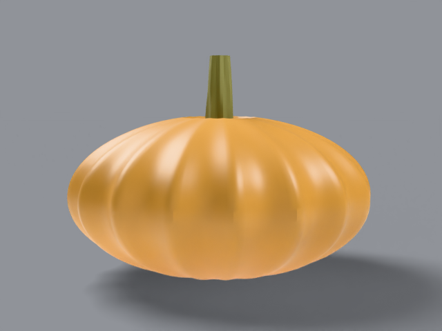

# long island cheese

old domestic cheese-type pumpkin, _cucurbita moschata_. 6–10 lb.
very flattened buff-tan wheel with the stem sunk in a recessed
well.

## what it looks like, top to bottom

crown: flat top with a deep stem well — the short stem sits
_inside_ it, not on top. ribs: 16–18 fine shallow ribs. skin:
buff tan, smooth, deeper in the valleys. stem: short, sunk in
the well. bottom: flat wheel base. uncarved — display fruit.

reference photos:
[`refs/long-island-cheese/`](../../refs/long-island-cheese/) —
`front.jpg`, `profile.jpg`. full spec:
[`refs/long-island-cheese/README.md`](../../refs/long-island-cheese/README.md).

## build

`blender/cultivars/long_island_cheese.py` — one script, no shared parameters.

1. flattened ribbed wheel from a polar grid.
2. a cylinder cutter
   [booleans](https://docs.blender.org/manual/en/latest/modeling/modifiers/generate/booleans.html)
   a recessed socket into the crown; the well floor is capped by
   hand. groove attribute rebuilt from positions after apply
   (booleans destroy custom attributes).
3. short woody ridged stem planted inside the socket.

rebuild: `blender -b --factory-startup --python-exit-code 1 -P blender/cultivars/long_island_cheese.py`

blender feature: boolean socket — holes for seats, not just
faces.

## finish in photocraft

warm midtone color balance, held shadows:

```
photocraft-cli run tutorial/variants/long-island-cheese.png \
  --cmd image.adjustments.colorBalance \
  --params '{"midtones":[12,6,-4]}' \
  --out post/variants/long-island-cheese.png
```

## renders





## scorecard

rubric: silhouette, ribs, color, surface, stem — mean, pass at 8.0.

| round | sil | ribs | color | surf | stem | mean | notes                                 |
| ----- | --- | ---- | ----- | ---- | ---- | ---- | ------------------------------------- |
| r1    | 8   | 7    | 8     | 7    | 7    | 7.4  | pale rind, buried stem                |
| r2    | 8   | 8    | 8     | 8    | 8    | 8.0  | PASS — deeper buff, raised woody stem |
