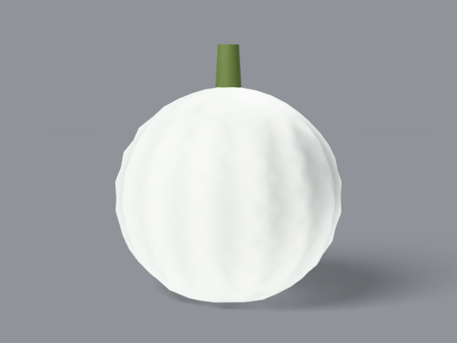
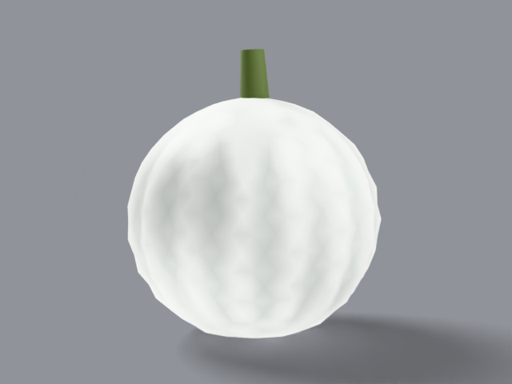

# lumina

white carving pumpkin, _cucurbita pepo_. 8–25 lb. rounded medium
fruit, smooth matte pure-white skin.

## what it looks like, top to bottom

crown: rounded top with a firm green upright stem. ribs: 14–16
shallow ribs, smooth matte skin. skin: pure white with soft grey
valleys, subsurface glow. stem: firm, green, upright. bottom:
sits round. uncarved — display fruit.

reference photos: [`refs/lumina/`](../../refs/lumina/) —
`front.jpg`, `profile.jpg`. full spec:
[`refs/lumina/README.md`](../../refs/lumina/README.md).

## build

`blender/cultivars/lumina.py` — one script, no shared parameters.

1. subdivided icosphere for even triangles, scaled tall-round,
   faint ribs displaced in python.
2. white rind with
   [subsurface scattering](https://docs.blender.org/manual/en/latest/render/shader_nodes/shader/principled.html)
   — light bleeds through instead of bouncing off. built to be
   lit from inside.

rebuild: `blender -b --factory-startup --python-exit-code 1 -P blender/cultivars/lumina.py`

blender feature: subsurface skin — the smooth-fruit study.

## finish in photocraft

cooling photo filter — moonlit, the deliberate opposite of the
generic's warm grade:

```
photocraft-cli run tutorial/variants/lumina.png \
  --cmd image.adjustments.photoFilter \
  --params '{"color":"#bfd9e8","density":15}' \
  --out post/variants/lumina.png
```

## renders





## scorecard

rubric: silhouette, ribs, color, surface, stem — mean, pass at 8.0.

| round | sil | ribs | color | surf | stem | mean | notes            |
| ----- | --- | ---- | ----- | ---- | ---- | ---- | ---------------- |
| r1    | 9   | 8    | 8     | 8    | 8    | 8.2  | PASS — first try |
