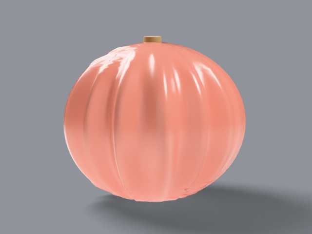

# porcelain doll

pink-skinned cultivar, _cucurbita maxima_. 10–25 lb. large,
squared, blocky, glossy.

## what it looks like, top to bottom

crown: rounded-square top with a tall corky fibrous stem. ribs:
12–14 strong vertical ribs, glossy highlights. skin: salmon pink,
glossy clearcoat, deeper groove valleys. stem: tall, tan, corky
and fibrous. bottom: sits flat, square footprint. uncarved —
display fruit.

reference photos:
[`refs/porcelain-doll/`](../../refs/porcelain-doll/) —
`front.jpg`, `profile.jpg`. full spec:
[`refs/porcelain-doll/README.md`](../../refs/porcelain-doll/README.md).

## build

`blender/cultivars/porcelain_doll.py` — one script, no shared parameters.

1. subdivided cube spherified to a sphere, so flat sides and
   square shoulders survive; faint square modulation re-added.
2. [weighted normal](https://docs.blender.org/manual/en/latest/modeling/modifiers/modify/weighted_normal.html)
   modifier for clean shading over the dense grid.
3. glossy coat shader; tall ridged corky stem with fiber bump.

rebuild: `blender -b --factory-startup --python-exit-code 1 -P blender/cultivars/porcelain_doll.py`

blender feature: cube to pumpkin — box-modeling origin, organic
result. (note: `bmesh.ops.subdivide_edges` with an edge list
silently no-ops in blender 4.4 — the script builds per-face grids
and welds with `remove_doubles` instead.)

## finish in photocraft

outer glow layer style, live pink halo, kept editable in the
shipped `.psd`:

```
photocraft-cli run tutorial/variants/porcelain-doll.png \
  --cmd layer.layerStyle.replace \
  --params '{"effects":[{"kind":"outerGlow","params":{"color":"#ff9ac0","opacity":0.5,"size":12}}]}' \
  --out post/variants/porcelain-doll.psd
```

## renders





## scorecard

rubric: silhouette, ribs, color, surface, stem — mean, pass at 8.0.

| round | sil | ribs | color | surf | stem | mean | notes                                   |
| ----- | --- | ---- | ----- | ---- | ---- | ---- | --------------------------------------- |
| r1    | 5   | 6    | 7     | 6    | 4    | 5.6  | pink box, tiny smooth stem              |
| r2    | 8   | 8    | 8     | 7    | 8    | 7.8  | taller body, corky stem; shoulders soft |
| r3    | 8   | 8    | 8     | 8    | 8    | 8.0  | PASS — square 0.10, darker grooves      |
