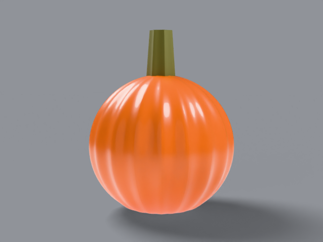

# sugar pie

new england pie standard, _cucurbita pepo_. about 15 cm across,
6–7 lb. small, neat, round.

## what it looks like, top to bottom

crown: rounded shoulder into a thick upright stem. ribs: 18–20
shallow ribs, smooth skin, light sheen. skin: bright orange, thin
rind look. stem: thick, upright, ridged, green-brown. bottom:
slightly flattened. uncarved — display fruit.

reference photos: [`refs/sugar-pie/`](../../refs/sugar-pie/) —
`front.jpg`, `profile.jpg`. full spec:
[`refs/sugar-pie/README.md`](../../refs/sugar-pie/README.md).

## build

`blender/cultivars/sugar_pie.py` — one script, no shared parameters.

1. bmesh uv sphere scaled to pie proportions, ribbed with a
   shallow radial displacement in python.
2. [subdivision surface](https://docs.blender.org/manual/en/latest/modeling/modifiers/generate/subdivision_surface.html)
   for the smooth grocery-pumpkin finish.
3. stem: hand-built ridged cylinder (7 bark ridges) with a
   mottled bark material.

rebuild: `blender -b --factory-startup --python-exit-code 1 -P blender/cultivars/sugar_pie.py`

blender feature: primitive-deform — start from a real primitive,
deform the verts, let subsurf finish the surface.

## finish in photocraft

hue/saturation warm shift — pie orange to porch orange:

```
photocraft-cli run tutorial/variants/sugar-pie.png \
  --cmd image.adjustments.hueSaturation \
  --params '{"hue":8,"saturation":10}' \
  --out post/variants/sugar-pie.png
```

## renders





## scorecard

rubric: silhouette, ribs, color, surface, stem — mean, pass at 8.0.

| round | sil | ribs | color | surf | stem | mean | notes                    |
| ----- | --- | ---- | ----- | ---- | ---- | ---- | ------------------------ |
| r1    | 8   | 8    | 8     | 7    | 7    | 7.6  | plain stem               |
| r2    | 8   | 8    | 8     | 8    | 8    | 8.0  | PASS — mottled bark stem |
