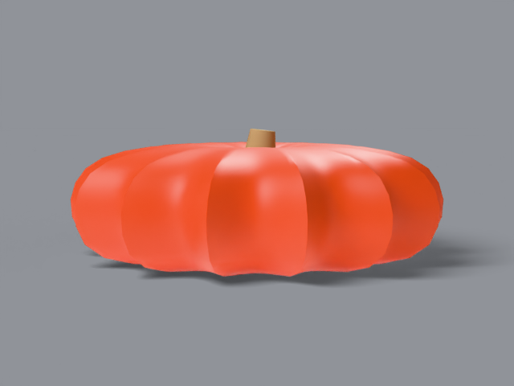
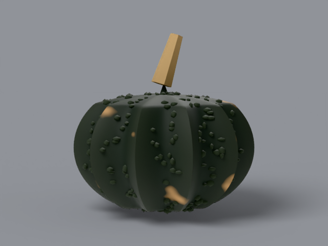
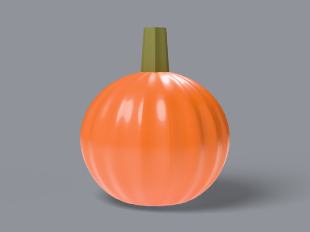
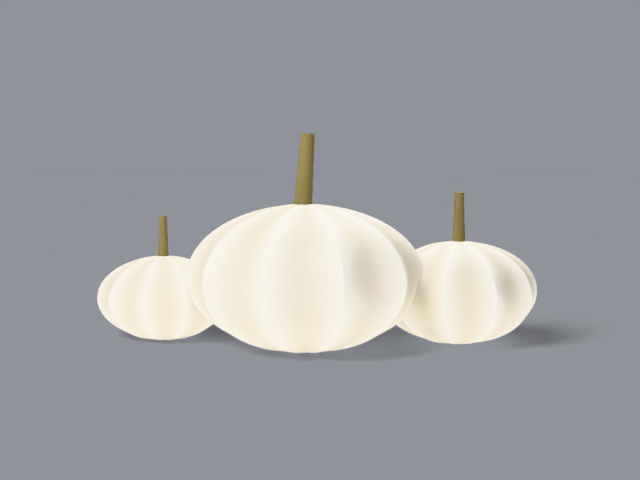
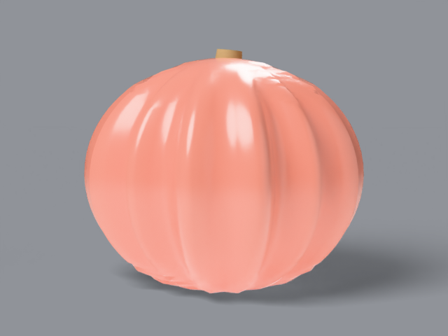
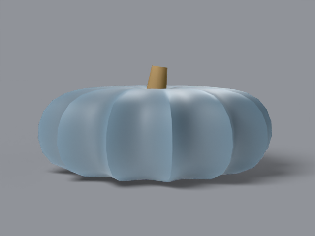
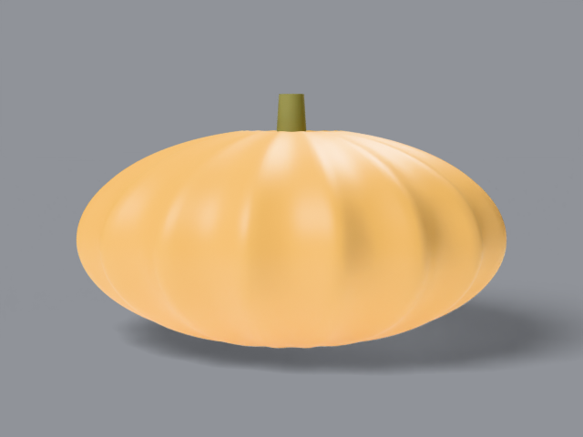
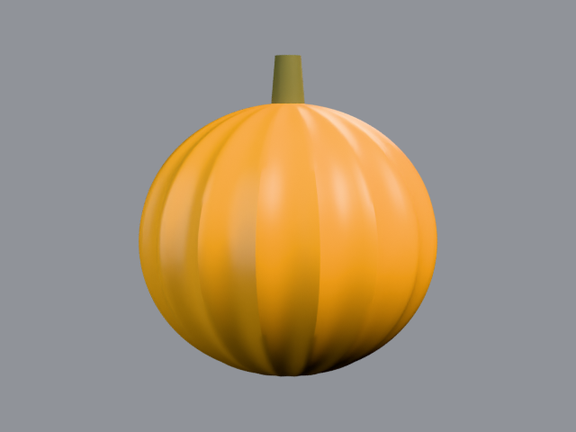
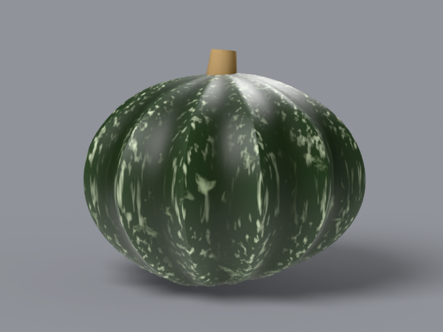

# making a blender pumpkin, step by step

build a stylized jack-o-lantern in blender 4.4 and finish it in
photocraft. every step comes two ways, and you can switch between them
at any point:

- **by hand** — the interface version: modifiers, shader nodes, grease
  pencil. best if you want to learn blender itself.
- **in code** — python from `blender/build_pumpkin.py`, annotated line
  by line. best if you want to rebuild, tweak values, and re-render.

the two tracks produce the same pumpkin. each step ends with a working
example scene in `tutorial/examples/` — open it, orbit around, compare
against your own file before moving on. no blender experience assumed
beyond opening the app and orbiting with the middle mouse button.

**what you need**

- blender 4.4 (any platform). everything here is free.
- photocraft 0.17 for step 6 (open source, runs offline). the
  `photocraft-cli` command line tool ships with it.
- about 20 minutes per step the first time through.

**render settings used throughout:** cycles engine, cpu device,
960x640 at 32 samples for finals, 480x320 at 10 samples for previews,
view transform standard. cpu keeps every laptop in the room usable;
the pumpkin is small enough that a final frame takes under a minute
on most machines.

**a note on units:** the scene is in metres. the pumpkin is 0.60 m
across — a big carving pumpkin. all numbers below are in metres
unless marked otherwise.

---

## step 0 — set the scene

**what you're doing:** an empty scene with the right renderer, the
right size, and a dark backdrop, so every later step lands on a
known stage.

**by hand**

1. start blender on the general template. you get a cube, a light,
   and a camera. select all (a) and delete (x, confirm).
2. right sidebar, scene properties (the icon that looks like a
   scene): render engine **cycles**, device **cpu**.
3. output properties: resolution x 960, y 640, 100%.
4. render properties > color management: view transform **standard**,
   look none, exposure **0.92**. (standard keeps the cartoon colors
   honest; filmic would mute them.)
5. world properties: click the color dot next to background, type
   `#0a0d13` (very dark blue-grey), strength **0.7**. this is the
   night sky your pumpkin will sit against.
6. file > save as, name it `scene.blend`. save often from here on
   (ctrl+s).

**in code** — the start of `main()` in `blender/build_pumpkin.py`:

```python
H.reset_scene()                     # delete everything, one collection
col = H.collection("Pumpkin")       # all pumpkin parts live here
```

`H` is a small helper module (`bpy_helpers.py`, from the blender
skill). it wraps plain `bpy` calls one-to-one — `H.reset_scene()`
deletes all objects, `H.collection(name)` creates and returns a
collection — so every snippet below also works as plain `bpy` with
a line or two more. the script always rebuilds from an empty scene:
rerunning it can never accumulate stray objects.

render settings are set once, in the render branches of `main()`:

```python
H.set_render(engine="CYCLES", resolution=(960, 640), samples=32,
             view_transform="Standard", exposure=P["exposure"],
             device="CPU")
```

**check your work:** press f12. you should see a dark blue-grey
rectangle and nothing else. boring is correct — that's the stage.

---

## step 1 — the ribbed body

**what you're doing:** a squat round body with 15 soft grooves and
real wall thickness. the groove pattern is also saved as data on the
mesh, because step 4's shading reads it back.

**by hand**

1. shift+a > mesh > uv sphere. in the add panel (bottom left):
   segments 64, rings 32, radius **0.30**. press alt+g first so the
   new ball starts at the world origin — the default add drops it
   at the 3d cursor, and every position below assumes origin.
2. with the sphere selected, open the object properties location
   and set z to **radius x z-scale**: 0.30 x 0.75 = **0.225**.
   half the ball above ground, none below. then scale: x **1.0**,
   y **0.92**, z **0.75** — slightly squashed top to bottom —
   and immediately ctrl+a > apply > scale. skipping apply is the
   classic silent bug: every later edit and the solidify rim
   measures the _unscaled_ ball and grooves, crater, and thickness
   all land wrong.
3. tab into edit mode. your grooves: count 15 around the middle.
   select every other longitudinal edge loop (alt+click a vertical
   edge, then select > checker deselect to thin the selection),
   then s and scale x/y inward to about **0.89** of the original
   radius. the selected loops sink, the others stay — grooves.
4. shade smooth (right-click the object > shade smooth). soft
   grooves, no facets.
5. stem crater: select the topmost vertex ring, g then z, move
   down **0.045**. the stem will sit in this dip.
6. sitting flat: select the bottom ring, scale z toward 1.0
   locally until the bottom looks gently flattened.
7. thickness (do not skip — carved holes need a wall to show):
   modifiers (wrench icon) > add > **solidify**. thickness
   **0.012**, offset **-1**, check **rim**. add a second material
   slot, a pale flesh color (`#f0b45c`), and set the modifier's
   rim material to slot 2 (material offset rim: 1).

**in code** — `build_body()` generates the sphere as a polar grid
instead of starting from a primitive, so the groove weight is exact:

```python
# for each ring j (top to bottom) and segment i (around):
#   phi = polar angle, a = azimuth
g = (0.5 - 0.5 * cos(N * (a - phase))) ** groove_pow
```

`g` is the groove weight: **1 in a valley, 0 on a crest**, shaped by
`groove_pow` (0.6 — wide soft valleys). the radius then dips with it:

```python
rr = R * (1 - groove_depth * g) * sin(phi)   # groove_depth = 0.115
x  = rr * sx * cos(a)                        # sx, sy, sz squash
z  = -cos(phi) * R * sz + CZ
```

each vertex stores `g` in a float attribute named `groove` — hold
on to that, step 4 mixes the rind color with exactly this mask.
`add_shell(body, flesh)` then applies the same solidify rim:

```python
mod = body.modifiers.new("Shell", "SOLIDIFY")
mod.thickness = 0.012; mod.offset = -1.0; mod.use_rim = True
```

**check your work:** open `tutorial/examples/01-body.blend`. orbit:
ribbed squash, darker in the grooves (viewport shading), no stem, no
face. render (f12): same, on dark blue-grey.

**if it goes wrong:**

- _faceted look_ — you missed shade smooth, or segments are low.
- _grooves too deep/shallow_ — that's the 0.89 scale (or
  `groove_depth` in code). 0.85 deep and spooky, 0.93 subtle.
- _hole walls invisible later_ — solidify rim is off, or the rim
  material slot doesn't exist yet.

**make it yours:** 10 grooves reads cartoonish, 20 reads like a
gourd. squash z to 0.65 for a flat field pumpkin, 0.9 for a tall
pie pumpkin.


---

## step 2 — stem, twig, leaves

**what you're doing:** a thick stem that hooks to one side, with
bark ridges, a broken hollow tip, one thin twiggy shoot, and four
small leaves. the stem carries a lot of the pumpkin's character —
spend the time.

**by hand**

1. shift+a > curve > bezier. place the first point in the crater
   dip from step 1. extrude (e) upward in stages, following this
   shape: straight up 0.15 m, then bending right, tip dropping
   slightly — like a question mark lying down.
2. object data properties (curve icon): bevel depth **0.030**,
   resolution 4. the stem is now a tube, but one thickness
   everywhere — too neat.
3. varying thickness: bevel taper needs a taper object. quicker
   path: convert to mesh (right-click > convert to > mesh), then
   in edit mode select rings from top to bottom and scale each:
   0.034 at the base flare, 0.030, 0.024, 0.020, 0.017, 0.014,
   0.012, 0.010 at the tip. (those are radii, halve them if you
   think in diameters.)
4. bark ridges: select every other small loop segment around the
   stem and pull outward about **12%** (s, then shift+z to keep
   length). seven ridges around reads right.
5. broken tip: delete the end cap face if there is one. add a small
   circle mesh (shift+a > mesh > circle, 10 vertices, radius
   0.007), place it 8 mm _inside_ the open end, dark brown. from
   any normal distance the stem now reads hollow and snapped.
6. twig: a second, thin bezier off the stem's left side partway
   up, one fork, bevel depth 0.003 tapering to 0.0012.
7. leaves: shift+a > mesh > plane, scale to about 13 mm long,
   pull one end to a point in edit mode (select far edge, s then
   0). make four, dark olive (`#6a6232`), rotate them to lie
   _along_ the twig, tips pointing away from the stem. leaves
   standing upright read as spikes; lying flat reads as leaves.

**in code** — `build_stem()` sweeps a circular profile along a
point list (`STEM_PATH`, each row is x, y, z, radius):

```python
# sweep_mesh() builds one ring of vertices per path point, faces
# between consecutive rings, then caps the base (cap_end=False
# leaves the tip open for the dark plug).
stem, centers, end_tg = sweep_mesh("Stem", pts, radii, n_sides=14,
                                   mat=stem_mat, col=col,
                                   cap_start=True, cap_end=False,
                                   ridges=7, ridge_amp=0.12)
```

two details do the heavy lifting:

- `ridges=7, ridge_amp=0.12` wobbles each ring's radius by ±12%
  with a 7-lobed wave — the bark ribbing is real geometry, not a
  texture, so it catches light at glancing angles.
- every vertex stores a `ridge` attribute (1 on a crest, 0 in a
  crevice). step 4's bark material mixes dark `#2a2410` and olive
  `#96905a` by exactly this attribute, so crevices stay dark
  without painting.

the twig and fork are the same sweep with 7 sides and millimetre
radii; the dark tip plug is a 10-vertex disc placed 8 mm back along
the end tangent, exactly like the by-hand version.

**check your work:** `tutorial/examples/02-stem.blend`. the stem
should look too big before it looks right — real pumpkin stems are
chunky. if yours looks like a candle wick, scale it up 1.3x.
proportional rule that survives resizing: build the stem for a
0.30 m body (tip about 0.48 m off the ground), then select stem +
twig + leaves and scale the whole assembly so the body's crater
meets the stem base. a mini pumpkin with a full-size stem reads as
a hook growing out of frame — the reader test caught exactly that.

**if it goes wrong:**

- _stem floats or sinks_ — the first path point must sit inside
  the crater dip (step 1), about z 0.335 in our scale.
- _inside-out shading (dark, inverted)_ — after converting a curve
  to mesh, mesh > normals > recalculate outside.
- _leaves read as spikes_ — rotate them flat, darken them (never
  paler than the stem), shrink 20%.


---

## step 3 — carve the face

**what you're doing:** cutting two triangular eyes and a wide
jagged grin _through_ the rind for real, then lining each hole with
a pale funnel (the cut flesh) and an amber glow cap (the candle
seen through the opening).

**sketch first.** our face, from the reference drawing in
`refs/hero.jpg`: left eye a tall triangle, right eye the same
triangle leaned onto the side rib so it wraps the curve, grin a
wide band with 4 upper teeth, 3 lower points, and pointed tips
swept up at both ends. triangles plus zigzag = classic, and reads
at favicon size.

**by hand**

1. numpad 1 (front view). shift+a > mesh > plane for the left eye.
   in edit mode shape it into a tall triangle about 0.08 m wide,
   0.085 m tall. position it left of center, mid-height.
2. duplicate for the right eye (shift+d), mirror (ctrl+m, x),
   move it right and rotate a few degrees so it leans with the
   pumpkin's curve.
3. grin: another plane, shaped into the zigzag band: top edge
   mostly straight with 4 downward points, bottom edge with 3
   upward points, tips at both ends swept up and pointed. width
   about 0.42 m — most of the pumpkin's front.
4. give each shape real depth: solidify, thickness **0.5**, or
   extrude in edit mode (e, z, 0.5). cutters must pass completely
   through the rind or the boolean leaves a skin.
5. select the body, modifiers > add > **boolean**, operation
   **difference**, object = left eye shape. apply. repeat for the
   right eye and the grin. (apply in order; booleans are happiest
   one at a time.)
6. hide the cutter shapes (eye icon in the outliner) — do not
   delete them yet, you may want to re-cut.
7. the glow, per hole: duplicate the hole outline on a new mesh,
   extrude _inward_ 0.045 m while scaling slightly smaller — a
   funnel. pale flesh material `#f0b45c`. then cap the deep end
   with the outline scaled to **0.80** (eyes) or **0.84** (grin):
   that's the glow cap.
8. glow cap material: material > new, emission. color gradient
   bright amber `#ffbe45` in the middle falling to deep orange
   `#ff8f16` at the edge (step 4 shows the node version; a flat
   `#ffab2e` emission at strength 0.75 already reads well).
9. the candle: shift+a > light > point, place inside the body at
   about (0.03, -0.10, 0.20), color `#ffb340`, power low (ours
   is 0.5 in script units). plus two small warm point lights just
   outside the mouth and nearest eye — light "spilling" out of
   the cuts onto the rind.

**in code** — the face is data. `EYE_L`, `EYE_R`, `GRIN` at the top
of `blender/build_pumpkin.py` are `(x, z)` outlines in metres:

```python
for name, outline in (("CutEyeL", EYE_L), ("CutEyeR", EYE_R),
                      ("CutGrin", GRIN)):
    c = H.add_extrusion(name, outline, depth=0.5,
                        location=(0, -0.18, 0), rotation=(90, 0, 0))
    H.boolean(body, c)      # difference by default in the helper
```

`add_extrusion` builds the flat outline, extrudes it 0.5 m, and the
(90, 0, 0) rotation stands it up facing the front (-y). boolean
rebuilds the mesh, which would lose the `groove` attribute from
step 1 — so `cut_face()` immediately recomputes it from final
vertex positions (same cosine formula). keep that trick: any time
an operation rebuilds your mesh, rebuild your masks too.

`build_cut_bevels()` then constructs each funnel ring-by-ring:

```python
# outer ring sits exactly on the hole outline, recessed 4 mm
# inside the rind surface; inner ring is the outline scaled to
# 0.80/0.84 and pushed 45 mm deep. faces between the rings are
# the pale cut wall; a cap across the inner ring carries the glow.
ov = [verts.new((x, surface_y(x, z) + wall_recess, z)) ...]
iv = [verts.new((x, surface_y(x, z) + wall_depth, z)) ...]
```

`surface_y()` answers "how deep is the rind surface at this
(x, z)?" so the funnel hugs the curved pumpkin instead of a flat
plane — that's what keeps pale slivers from poking outside the
cuts on the curved parts.

**check your work:** `tutorial/examples/03-carved-face.blend`.
zoom into a cut edge: outer skin, pale flesh wall, glowing
interior, in that order. orbit to the side: the right eye visibly
wraps the rib.

**if it goes wrong:**

- _a hole stayed skinned over_ — cutter didn't pass through the
  whole rind. make it deeper; check from the side view.
- _pale slivers outside the cuts_ — the funnel's outer ring is
  bigger than the hole. it must match the outline exactly.
- _glow looks flat_ — the cap is too close to the surface, or
  emission is off. push the cap deeper (0.045 m) and check the
  material is emission, not diffuse.

**make it yours:** change any outline list and re-run — fangs
(two long lower points), round eyes (16-gon outlines), a crescent
mouth. asymmetrical faces (one eye winked shut: scale y by 0.2)
have enormous personality per minute spent.


---

## step 4 — shading layers

**what you're doing:** the rind stays flat cartoon orange but still
shows form. four layers, in order: (1) toon base, (2) groove shading
from the step-1 mask, (3) painterly streaks so large areas don't
look like plastic, (4) a warm rim that only fires on the silhouette.
work in the shading workspace, body material selected.

**by hand — build this node tree**

| #   | node (shift+a path)    | settings                                          | wire it to                          |
| --- | ---------------------- | ------------------------------------------------- | ----------------------------------- |
| 1   | shader > toon bsdf     | component diffuse, size **0.62**, smooth **0.06** | color from #8 below                 |
| 2   | shader > toon bsdf     | component glossy, color `#e06a10`, size 0.15      | mix shader (10%) with #1            |
| 3   | input > attribute      | name `groove`                                     | math power 2.8                      |
| 4   | converter > math       | power, exponent **2.8**                           | factor of mix #5                    |
| 5   | converter > mix (rgba) | a `#f07818` lit orange, b `#6e2f0c` groove brown  | into #8 input a                     |
| 6   | texture > noise (x2)   | scales **14** and **28**, detail 3 and 2          | map range 0.35–0.65, then averaged  |
| 7   | vector > bump          | strength **0.06**, height from fine noise (#6b)   | normals of #1 and #2                |
| 8   | converter > mix (rgba) | streak output over #5 output                      | color of #1                         |
| 9   | converter > math chain | 1 − groove, power 2.5, multiply 0.45              | factor of #10                       |
| 10  | converter > mix (rgba) | b `#ff9a30` hot orange (rib-crest lift)           | color of #1 (chain with #8)         |
| 11  | input > layer weight   | 1 − facing                                        | multiply #13                        |
| 12  | input > geometry       | normal x, ramp: −0.90 add, ×9, clamp 0..1         | multiply #13                        |
| 13  | converter > math       | multiply (#11 × #12) = rim gate                   | emission #14 color factor           |
| 14  | shader > emission      | color `#ffe6b0`, strength **1.7**                 | add shader with toon mix, to output |

read the table as a recipe: toon does the cartoon, groove does the
form, noise does the hand-painted feel, rim does the candlelit edge.
the rim gate (#11–#13) is the only fiddly part: it asks "is this
point on the outer-right silhouette, seen at a grazing angle?" —
both conditions must hold, so rims never paint stripes across the
front of the pumpkin.

**glow caps** (step 3's caps, per hole): emission whose color mixes
`#ff8f16` (edge) to `#ffbe45` (center). drive it with geometry
position z through a map range centered on the hole's own middle
height, so every opening is brightest in _its_ middle. strength
0.75. stem bark: principled bsdf, base color mixed `#2a2410` to
`#96905a` by the `ridge` attribute from step 2, roughness 0.85.

**in code** — `rind_material()` builds exactly this tree. the two
ideas worth stealing:

```python
attr = nt.nodes.new("ShaderNodeAttribute")
attr.attribute_name = "groove"      # step 1's per-vertex weight
pw = nt.nodes.new("ShaderNodeMath")
pw.operation = "POWER"              # 2.8 sharpens valley falloff
pw.inputs[1].default_value = 2.8
# mix.inputs: A = streaked lit orange, B = groove brown,
# Factor = pw output. crests stay lit, valleys sink.
```

and the rim, built from plain math nodes because they clamp
predictably:

```python
# gate = clamp((normal_x - 0.90) * 9, 0, 1) * (1 - facing)
# only the outer-right limb at a grazing view passes the gate,
# and only that sliver gets the #ffe6b0 emission added.
```

**check your work:** render (f12) and compare against
`blender/exports/render.png`. crests hot orange, grooves deep
brown-orange, a warm edge on the right silhouette, glow strongest
mid-hole. viewport rendered shading (z > rendered) gets you 80%
of the way while tuning.

**if it goes wrong:**

- _plastic toy look_ — the noise streaks are missing or the toon
  smooth is too high. streaks first; they matter more than detail.
- _rim stripe down the front_ — the gate lost its facing term.
  both multiplies (#13) must be present.
- _grooves invisible_ — the `groove` attribute didn't survive an
  edit. re-check step 3's recompute after booleans.
- _color looks washed_ — view transform drifted to filmic.
  standard, look none.

**make it yours:** toon size 0.8 = flatter cartoon, 0.4 = soft
clay. groove exponent 2.0 widens the dark valleys (moodier),
4.0 tightens them to pinstripes.

---

## step 5 — ink it with grease pencil

**what you're doing:** drawn black-brown outlines that follow the
3d forms, so the render reads as an illustration. grease pencil in
blender 4.4 is a full object type with its own layers and
materials — and a line art modifier that traces your meshes.

**by hand**

1. object > add > **grease pencil > stroke**. rename the object
   `Outlines`. (pick the stroke preset: it initializes the stroke
   material styles. a grease pencil material made from scratch
   has no stroke color to set — this bites everyone once.)
2. grease pencil properties: delete the default layers, add one
   layer named `Lines`. material properties: rename `Black` to
   `OutlineStroke`, stroke color near-black brown
   (0.012, 0.005, 0.0025), show stroke on.
3. modifiers on `Outlines` > add > **line art**:
   - source type **collection**, source = your pumpkin collection
   - **contour** on (outer silhouettes), **crease** on (rib edges),
     **intersection** on (where cuts meet skin)
   - thickness **3**, crease threshold **0.70** radians-ish
   - target layer `Lines`, target material `OutlineStroke`
4. groove emphasis: thin tubes already help (by-hand version:
   curve > circle, radius **0.0012**, dark brown emission, hugging
   each valley). keep tubes **9 mm away** from the carved holes —
   a tube crossing a recessed funnel renders as a stray dash
   floating in the glow.
5. compositor (compositing workspace, use nodes): glare node
   between render layers and composite — **fog glow**, quality
   high, threshold **0.85**, size **6**, mix **0.5**. highlights
   and glow caps bloom; the ink stays crisp.

**in code** — `setup_outlines()`:

```python
bpy.ops.object.grease_pencil_add(type="STROKE", location=(0, 0, 0))
gp = bpy.context.active_object
gp.name = "Outlines"
# ... layers swapped for "Lines", Black -> OutlineStroke ...
mod = gp.modifiers.new("LineArt", "LINEART")
mod.source_type = "COLLECTION"
mod.source_collection = source_col
mod.use_contour = True; mod.use_crease = True
mod.use_intersection = True; mod.use_material = True
mod.thickness = P["line_thickness"]        # 3 shaded, 6 drawing
mod.crease_threshold = P["crease_threshold"]
```

`build_groove_lines()` draws the valley tubes and splits them
around the holes with a 9 mm margin — exactly the by-hand rule,
automated with a point-in-polygon test against `EYE_L`, `EYE_R`,
`GRIN`.

**lights and camera (both tracks):** camera 70 mm, dead front,
slight elevation (3°), subject fills ~90% of frame — framed on
the pumpkin itself, not the ground. if the body floats small in
frame, halve the camera distance before anything else. key area
light front-right-top, warm `#fff1e0`; fill front-left, cool
`#e8f0ff` at 75%; rim back-right, warm `#ffd9b0`. world stays the
step-0
dark blue-grey.

**check your work:** `tutorial/examples/04-inked-final.blend`
against `blender/exports/render.png`. outlines on every rib and
cut, none floating in the glow. now the drawing: render with
line thickness **6**, white background, no glare node — that's
`blender/exports/render_toon.png`, a coloring page of your pumpkin.

**if it goes wrong:**

- _no lines at all_ — the line art source is an object, not the
  collection, or your meshes aren't in that collection.
- _lines everywhere, mushy_ — crease threshold too low. raise
  toward 1.0; contour-only is a clean fallback style.
- _dashes inside the glow_ — groove tubes too close to holes.
  enforce the 9 mm margin.


## run the whole build

at any point, rebuild everything from the script:

```
blender -b --factory-startup --python-exit-code 1 -P blender/build_pumpkin.py
```

| command suffix                  | result                                               |
| ------------------------------- | ---------------------------------------------------- |
| (none)                          | shaded final, `blender/exports/render.png`           |
| `-- --toon`                     | inked drawing on white, `render_toon.png`            |
| `-- --preview`                  | small fast render, `preview.png` (iterate with this) |
| `-- --stage=1` … `-- --stage=4` | rebuilds the `tutorial/examples/` scenes             |
| `-- --turntable`                | 24 orbit frames, `blender/exports/frames/`           |

the `-b` flag runs blender without a window; drop it and the same
script builds the scene in the interface, where you can take over
by hand. every value worth tuning lives in the `P` dict at the top
of `blender/build_pumpkin.py` — groove depth, glow colors, rim
strength, line thickness — change one, re-render, compare.

---

## step 6 — grade it in photocraft

**what you're doing:** the render is finished; now give it a
candlelit finish. five adjustments, in order. photocraft is an
open-source image editor written in rust — layers, masks,
adjustment layers, real psd files, fully offline. open
`blender/exports/render.png` in photocraft and follow along, or run
the identical steps from a terminal with `photocraft-cli`, which
ships with the app. `post/post.sh` contains the exact commands;
the outputs are in `post/` so you can diff against yours.

**1. vibrance 35, saturation 12** (image > adjustments > vibrance)

vibrance lifts muted colors harder than already-loud ones, so the
orange rind deepens without the yellow glow clipping. plain
saturation would blow the glow first — that's why vibrance leads.

```
photocraft-cli run blender/exports/render.png \
  --cmd image.adjustments.vibrance \
  --params '{"vibrance":35,"saturation":12}' \
  --out post/step1.png
```

**2. brightness -6, contrast +22** (image > adjustments >
brightness/contrast)

a small contrast push separates the pumpkin from the night
background and deepens the grooves. brightness dips slightly so
the contrast doesn't lift the blacks into grey.

**3. warm photo filter `#ff9a30` at 18%** (image > adjustments >
photo filter)

a warming filter at low density shifts the whole image toward
candlelight. 18% is a tint, not a costume — past 30% the greens
in the stem go muddy.

**4. the glow** (the one worth learning)

1. duplicate the layer (layer > duplicate layer).
2. filter > blur > gaussian blur, radius **8**, on the copy.
3. set the copy's blend mode to **screen**, opacity **60%**.

screen blend adds light where the image is already bright and
leaves darks alone, so the blurred copy becomes a halo that only
exists around the glow and highlights — candlelight bloom,
without touching the ink lines in the shadows.

```
photocraft-cli run post/render_post.png \
  --cmd layer.duplicate \
  --cmd filter.blur.gaussianBlur --params '{"radius":8}' \
  --cmd layer.setProps \
  --params '{"blendMode":"screen","opacity":0.6}' \
  --cmd layer.flattenImage \
  --out post/render_post_glow.png
```

(opacity in the command line is 0..1, so 0.6 means 60%.)

**5. keep two files**

- flattened png for sharing: `post/render_post_glow.png`.
- the unflattened stack saved as `.psd`: `post/render_post.psd`.
  it opens in photocraft (or photoshop) with both layers intact,
  so the glow stays adjustable forever.

**check your work:** toggle the blurred layer off and on. off:
crisp but cool. on: the cuts breathe light onto the rind and the
edges soften into the dark. if everything blooms, opacity is too
high or the blur radius too big — 40% and radius 5 is the subtle
end.

**if it goes wrong:**

- _glow looks milky_ — screen at 100% flattens contrast. stay at
  60% or below.
- _colors went neon_ — vibrance and the photo filter stack. drop
  the filter density to 10% before touching vibrance.
- _psd lost its layers_ — you flattened before saving the psd.
  save the layered file first, flatten a copy.

---

## where to go next

**new faces.** in code, edit `EYE_L`, `EYE_R`, `GRIN` — any closed
(x, z) outline flows through the cutter, funnel, and glow builders
unchanged. by hand, draw new cutter shapes and re-boolean. fangs:
extend two lower points. wink: scale one eye's y by 0.2.

**a turning pumpkin.** `-- --turntable` renders 24 orbit frames.
stitch them into a looping animated webp (5 frames per second is
a calm turn — a full rotation every 4.8 seconds):

```
python3 -c "
from PIL import Image
frames = [Image.open(f'blender/exports/frames/f{i:02d}.png') for i in range(24)]
frames[0].save('pumpkin-spin.webp', save_all=True,
               append_images=frames[1:], duration=200, loop=0, quality=80)"
```

**a coloring page.** print `blender/exports/render_toon.png` as
is, or raise line thickness to 8 in `P` for younger hands.

**a bigger scene.** duplicate the pumpkin, vary groove count and
squash per copy, add a ground plane with a radial gradient dark
material, and let the inner lights spill. the build is one
function call per pumpkin in code — or alt+d linked duplicates
by hand, so one material edit restyles the whole patch.

**troubleshooting index**

| symptom                   | likely cause                       | where  |
| ------------------------- | ---------------------------------- | ------ |
| faceted pumpkin           | shade smooth missed                | step 1 |
| skinned-over holes        | cutter too shallow                 | step 3 |
| pale slivers outside cuts | funnel outline oversized           | step 3 |
| plastic look              | streak layer missing               | step 4 |
| rim stripe on the front   | rim gate lost facing term          | step 4 |
| no grease pencil lines    | line art source not the collection | step 5 |
| dashes in the glow        | groove tubes inside 9 mm margin    | step 5 |
| milky grade               | screen blend above 60%             | step 6 |

## ten more pumpkins (cultivar gallery)

the generic pumpkin is one build of `blender/build_pumpkin.py`. every
cultivar below is its own script in `blender/cultivars/` — separate
file, separate construction, no shared parameters. each is a whole
uncarved display fruit (the reference photos in `refs/<name>/` are
uncarved), built front-first against its spec in
`refs/<name>/README.md`. rebuild any of them with:

`blender -b --factory-startup --python-exit-code 1 -P blender/cultivars/<name>.py`

each entry shows the raw front render and the graded result. the
side-profile render sits beside it (`variants/<name>-profile.png`).
exact post chains in `post/variants.sh`.

key: **b** = blender feature shown, **p** = photocraft feature shown.
terms link out on first use: the
[blender manual](https://docs.blender.org/manual/en/latest/)
and [photocraft](https://github.com/storytold/photocraft).

### 1. cinderella (rouge vif d'etampes)

french heirloom: very flat wide disc, concave crown, 14 deep ribs,
red-orange skin. build: `blender/cultivars/cinderella.py` revolves a
measured side profile ([spin](https://docs.blender.org/manual/en/latest/modeling/meshes/editing/duplicate_extrude/spin.html)
tool equivalent), then modulates each ring with a 14-fold rib
function. spec: `refs/cinderella/README.md`.

 

**b — profile lathe + proportional crown.** the concave dip is part
of the profile polyline, and the short corky stem seats into it.

**p — curves adjustment layer** (`layer.newAdjustmentLayer.curves`

- `layer.setAdjustment {"red":[[0,0],[64,48],[192,208],[255,255]]}`).
  red-channel s-curve; the shipped `.psd` keeps the curve live.

### 2. black futsu

japanese heirloom: squat blocky fruit, wart rows along the ribs,
dark green curing toward buff. build:
`blender/cultivars/black_futsu.py` — ribbed body plus a
[geometry nodes](https://docs.blender.org/manual/en/latest/modeling/geometry_nodes/index.html)
tree that distributes points on faces masked to rib crests and
instances a wart prototype on them. spec:
`refs/black-futsu/README.md`.

 

**b — scatter + [instance on points](https://docs.blender.org/manual/en/latest/modeling/geometry_nodes/point/instance_on_points.html).**
real wart geometry, seeded, density driven by the groove attribute.

**p — brightness/contrast**
(`image.adjustments.brightnessContrast
{"brightness":28,"contrast":18}`). lifts the dark rind for print.
threshold was tried first and ignored its level in photocraft
0.17, so the lift stands in — recorded, not hidden.

### 3. sugar pie

new england pie standard: small neat ball, shallow ribs, smooth
bright rind, thick ridged upright stem. build:
`blender/cultivars/sugar_pie.py` — a bmesh uv sphere scaled to pie
proportions, ribbed in python, smoothed with a
[subdivision surface](https://docs.blender.org/manual/en/latest/modeling/modifiers/generate/subdivision_surface.html).
spec: `refs/sugar-pie/README.md`.

 

**b — primitive-deform.** start from a real primitive, deform the
verts, let subsurf finish the surface.

**p — hue/saturation** (`image.adjustments.hueSaturation
{"hue":8,"saturation":10}`). pie orange to porch orange.

### 4. baby boo

miniature white minis that grow in clusters. build:
`blender/cultivars/baby_boo.py` builds one ribbed mini, then places
two [linked duplicates](https://docs.blender.org/manual/en/latest/scene_layout/object/editing/linked_duplicates.html)
at varied rotation and scale — same mesh, no rebuild. spec:
`refs/baby-boo/README.md`.

 

**b — linked duplicates.** one material edit restyles the cluster.

**p — invert** (`image.adjustments.invert`). white pumpkins become
a ghost negative.

### 5. porcelain doll

pink blocky fruit with square shoulders. build:
`blender/cultivars/porcelain_doll.py` — a subdivided cube spherified
to a sphere, so flat sides survive, with a
[weighted normal](https://docs.blender.org/manual/en/latest/modeling/modifiers/modify/weighted_normal.html)
modifier and a glossy coat shader. spec:
`refs/porcelain-doll/README.md`.

 

**b — cube to pumpkin.** box modeling origin, organic result.

**p — outer glow layer style** (`layer.layerStyle.replace`
`{"effects":[{"kind":"outerGlow","params":{"color":"#ff9ac0",
"opacity":0.5,"size":12}}]}`). live pink halo, kept editable in
the shipped `.psd`.

### 6. jarrahdale

australian heirloom: slate blue-grey flattened drum, dusty bloom.
build: `blender/cultivars/jarrahdale.py` revolves a drum profile;
the bloom is a
[principled](https://docs.blender.org/manual/en/latest/render/shader_nodes/shader/principled.html)
sheen layer masked to rib valleys, not geometry. spec:
`refs/jarrahdale/README.md`.

 

**b — sheen for bloom.** dusty skin without dusty vertices.

**p — gradient map** (`layer.newAdjustmentLayer.gradientMap`,
shadows `#4a5a64` to highlights `#e88a30`). slate-to-amber
duotone, map kept live in the `.psd`.

### 7. lumina

smooth white ball, green stem. build:
`blender/cultivars/lumina.py` — subdivided icosphere for even
triangles, faint ribs, white rind with
[subsurface scattering](https://docs.blender.org/manual/en/latest/render/shader_nodes/shader/principled.html)
so it reads lit from within. spec: `refs/lumina/README.md`.

 

**b — subsurface skin.** the smooth-fruit study.

**p — photo filter, cooling** (`image.adjustments.photoFilter
{"color":"#bfd9e8","density":15}`). moonlit, opposite of the
generic's warm grade.

### 8. long island cheese

buff-tan wheel with the stem sunk in a recessed well. build:
`blender/cultivars/long_island_cheese.py` — flattened ribbed wheel,
then a [boolean](https://docs.blender.org/manual/en/latest/modeling/modifiers/generate/booleans.html)
cutter sockets the crown and the short stem plants inside it.
spec: `refs/long-island-cheese/README.md`.

 

**b — boolean socket.** holes for seats, not just faces.

**p — color balance** (`image.adjustments.colorBalance
{"midtones":[12,6,-4]}`). warm mids, held shadows.

### 9. harvest moon

big golden ball. build: `blender/cultivars/harvest_moon.py` — a
smooth globe whose point is the documented three-point area-light
rig (warm key, cool fill, warm rim, values in the file). spec:
`refs/harvest-moon/README.md`.

 

**b — studio lighting** ([area lights](https://docs.blender.org/manual/en/latest/render/lights/index.html),
documented values). gold reads without blowing out.

**p — levels** (`image.adjustments.levels
{"shadowInput":18,"gamma":0.95}`). black point in for night
contrast. compare with cinderella's curves: curves shape, levels
range.

### 10. kabocha

dark drum with celadon mottling and pale crest stripes, all
procedural. build: `blender/cultivars/kabocha.py` — a drum body
whose [noise texture](https://docs.blender.org/manual/en/latest/render/shader_nodes/textures/noise.html)
drives both the color mix and a displace modifier, with a
stretched second mapping for the stripes. spec:
`refs/kabocha/README.md`.

 

**b — texture coordinates + mapping.** mottling without painting.
(note: the musgrave shader node is gone in blender 4.4 — noise
with distortion stands in; the legacy texture still feeds the
displace modifier.)

**p — channel mixer** (`image.adjustments.channelMixer
{"red":[100,20,0,0],"green":[0,80,20,0],"blue":[0,0,100,0]}`).
rows are four numbers (r,g,b,constant).

## how records are kept

every cultivar above carries a spec in `refs/<name>/README.md`:
reference photos, measured proportions, construction plan, and the
acceptance line (render matches the profile silhouette). nothing
here is claimed that isn't rendered in `tutorial/variants/` beside
it — each cultivar has a front png, a `-profile.png`, and a
`.blend` from its own script.

the tutorial text itself was reader-tested: two fresh pumpkins
(plain-white, flat-tan) built from these steps alone, no script
constants, renders in `tutorial/reader/`. every place the text
misled got fixed and the step rebuilt — crater placement, stem
scaling, and camera framing were all caught this way.
